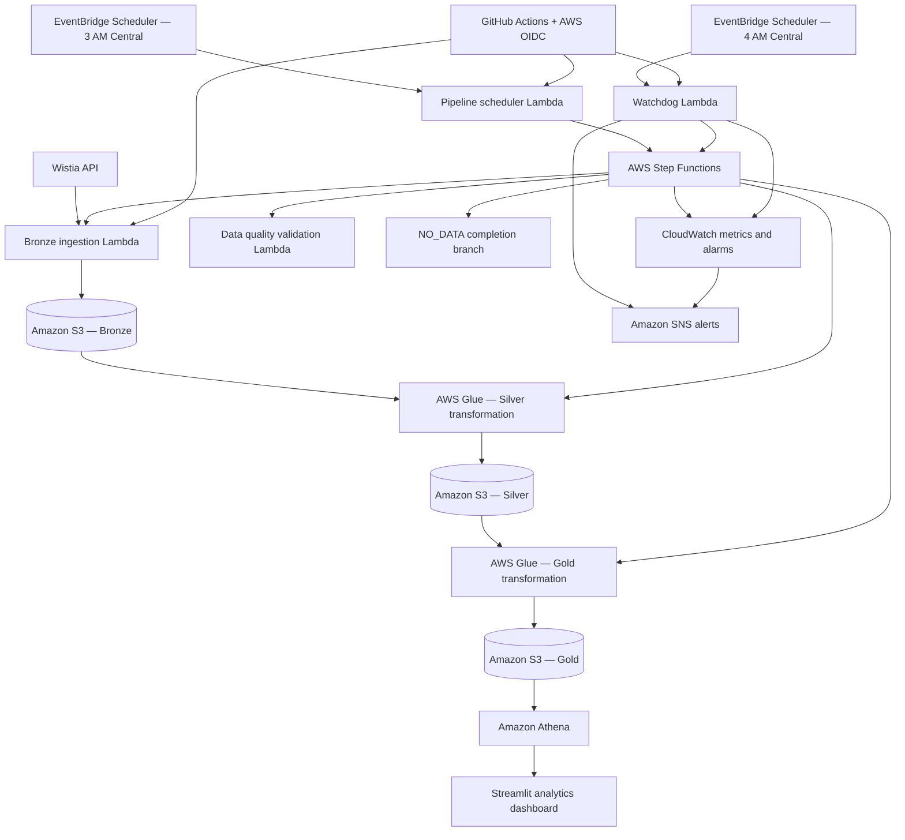

# Wistia Video Analytics — End-to-End AWS Data Engineering

**Status:** Core implementation and scheduled operational verification complete  
**Environment:** `dev` | **AWS Region:** `us-east-1` | **Last verified:** October 26, 2026  
**Repository:** [Dea-e2e-Wista-Video-Analiytics](https://github.com/rrober07/Dea-e2e-Wista-Video-Analiytics) (private repository; access required)

## Executive summary

This project implements an automated, production-style analytics pipeline for Wistia video engagement data on AWS. It combines API ingestion, layered data transformation, quality validation, SQL analytics, visualization, orchestration, continuous integration/deployment, and operational alerting.

The workflow runs daily using Central Time. A separate watchdog checks that the expected Step Functions execution exists and publishes an SNS notification when it does not. The project is implemented in a development environment and uses production-style controls; it is **not** represented here as a formally production-certified system.

## Architecture



**Flow qualification:** The diagram represents the implemented logical architecture. Exact Glue job names, S3 bucket/prefix names, catalog tables, and dashboard hosting details should be copied from deployed AWS resources before publishing a full infrastructure inventory. The daily workflow has a deliberate `NO_DATA` branch; not every successful run necessarily produces new Silver/Gold records.

## Pipeline design

| Layer or service | Responsibility |
|---|---|
| Bronze — Lambda + S3 | Ingest Wistia API events and persist raw data / run manifest |
| Silver — AWS Glue | Transform and standardize raw records |
| Gold — AWS Glue | Produce analytics-ready data |
| Data quality — Lambda | Validate pipeline outputs and surface quality results |
| Athena | Query curated datasets with SQL |
| Streamlit | Present video analytics to end users |
| Step Functions | Coordinate ingestion, transformations, validation, and the no-data path |

### Daily processing semantics

- The daily scheduler determines the **previous calendar day in `America/Chicago`** and uses that date as both `start_date` and `end_date`.
- The execution name follows `wistia-daily-YYYY-MM-DD`, enabling an idempotent daily execution strategy.
- When ingestion yields no events, the state machine may complete through `NO_DATA` without invoking downstream transformation stages.
- When events exist, the workflow is designed to continue through Silver, Gold, and data-quality stages.
- The scheduler Lambda recognizes an already-started execution and returns `ALREADY_STARTED` instead of treating it as a new execution.

## Deployed AWS resources

**Account:** `214118274300`  
**Region:** `us-east-1`

| Resource | Identifier |
|---|---|
| State machine | `wistia-video-analytics-dev` |
| State machine ARN | `arn:aws:states:us-east-1:214118274300:stateMachine:wistia-video-analytics-dev` |
| Ingestion Lambda | `wistia-events-ingestion-dev` |
| Daily scheduler Lambda | `wistia-pipeline-scheduler-dev` |
| Data-quality Lambda | `wistia-data-quality-validator-dev` |
| Watchdog Lambda | `wistia-pipeline-watchdog-dev` |
| Daily EventBridge schedule | `wistia-video-analytics-daily-dev` |
| Watchdog EventBridge schedule | `wistia-pipeline-watchdog-daily-dev` |
| SNS alerts topic | `arn:aws:sns:us-east-1:214118274300:wistia-video-analytics-dev-alerts` |

### Schedule configuration

| Schedule | Time zone | Expression | Target |
|---|---|---|---|
| Daily pipeline | `America/Chicago` | `cron(0 3 * * ? *)` | `wistia-pipeline-scheduler-dev` |
| Missed-run watchdog | `America/Chicago` | `cron(0 4 * * ? *)` | `wistia-pipeline-watchdog-dev` |

Both schedules were observed as **Enabled** in the AWS Console on October 26, 2026. They use timezone-aware scheduling to accommodate Central Time daylight saving transitions. The watchdog checks whether the expected execution exists; it does not independently verify the correctness of analytics output.

## Security and access controls

- **AWS IAM roles** are assigned to runtime components; the watchdog uses `WistiaPipelineWatchdogRole` with `AWSLambdaBasicExecutionRole` and a narrowly scoped inline policy.
- The watchdog's custom policy grants `states:DescribeExecution` for the daily state machine's named executions and `sns:Publish` for the Wistia alert topic.
- **GitHub Actions OIDC** assumes `WistiaGitHubDeployRole` rather than storing long-lived AWS access keys in GitHub.
- `WistiaGitHubLambdaDeployPolicy` grants `lambda:UpdateFunctionCode`, `lambda:GetFunction`, and `lambda:GetFunctionConfiguration` on the three deployable Lambda functions only.
- The workflow requires the literal confirmation `DEPLOY` for code updates and serializes deployments by target.
- The EventBridge Scheduler invokes the watchdog through a separate scheduler execution role with `lambda:InvokeFunction` access to the watchdog Lambda.
- Local AWS CLI identities were observed to have restricted Lambda configuration and EventBridge schedule read permissions; administrator Console access was used for initial resource configuration.

**Security boundary:** CI/CD can update code for the authorized functions but does not have broad Lambda creation, IAM administration, or runtime configuration permissions. Review secrets handling, encryption settings, S3 access policies, and data classification against your organization’s requirements before a production launch.

## CI/CD

Repository workflows:

| Workflow | Purpose |
|---|---|
| `.github/workflows/python-ci.yml` | Python source validation and unit tests on repository changes |
| `.github/workflows/lambda-deploy.yml` | Manually authorized AWS OIDC deployment of ingestion, scheduler, or watchdog Lambda |

The deployment workflow supports `verify-only`, `ingestion`, `scheduler`, and `watchdog` targets. Deployment packages are built by `scripts/build_lambda_packages.py` and checked for required files and ZIP integrity. The `verify-only` target checks AWS identity and existing Lambda access without deploying code.

**Verified:** Commit `8a73c11` (`Add watchdog Lambda monitoring and CI/CD deployment`) was pushed to `main`; Python CI passed; GitHub Actions `verify-only` and `watchdog` deployment jobs succeeded.

## Monitoring and alerting

The SNS topic `wistia-video-analytics-dev-alerts` receives notifications from CloudWatch alarms and the watchdog’s missing-execution check.

| CloudWatch alarm | Metric | Trigger |
|---|---|---|
| `wistia-pipeline-execution-failed-dev` | Step Functions `ExecutionsFailed` | ≥ 1 in 5 minutes |
| `wistia-pipeline-execution-timeout-dev` | Step Functions `ExecutionsTimedOut` | ≥ 1 in 5 minutes |
| `wistia-pipeline-execution-aborted-dev` | Step Functions `ExecutionsAborted` | ≥ 1 in 5 minutes |
| `wistia-pipeline-watchdog-errors-dev` | Lambda `Errors` | ≥ 1 in 5 minutes |

All four alarms were present with actions enabled on October 26, 2026. The three Step Functions alarms were `OK`. The watchdog error alarm showed `Insufficient data`, which is not evidence of a failure; verify its missing-data treatment is **not breaching**.

All four Lambda log groups were observed with **1 month (30 days)** retention:

- `/aws/lambda/wistia-events-ingestion-dev`
- `/aws/lambda/wistia-pipeline-scheduler-dev`
- `/aws/lambda/wistia-data-quality-validator-dev`
- `/aws/lambda/wistia-pipeline-watchdog-dev`

**Monitoring limitation:** The watchdog alerts when the expected Step Functions execution is absent. A watchdog that is never invoked may produce neither a Lambda error metric nor a missing-run SNS alert. A separate heartbeat or EventBridge delivery-failure monitor would close that gap.

## Testing and operational evidence

### Automated tests

On October 25, 2026, the local suite completed **12 tests with zero failures**, covering:

- Daily scheduler start, duplicate-execution handling, and AWS error propagation.
- Central Time date selection, month/year boundaries, and daylight saving transitions.
- Watchdog found/missing-execution behavior and AWS error propagation.

GitHub Python CI passed for commit `8a73c11`.

### October 26, 2026 scheduled run

| Check | Observed evidence | Result |
|---|---|---|
| Daily execution | `wistia-daily-2026-10-25` started 03:00:47 Central, ended 03:00:50 | `SUCCEEDED` |
| Previous daily execution | `wistia-daily-2026-10-24` | `SUCCEEDED` |
| Watchdog invocation | New CloudWatch log stream at approximately 04:00 Central (09:00 UTC) | Invoked |
| Watchdog lookup | `processing_date=2026-10-25`, `execution_name=wistia-daily-2026-10-25` | `FOUND` |
| Reported execution status | Watchdog log | `SUCCEEDED` |
| Missing-run notification | Watchdog log | `alert_sent=false` |
| Watchdog invocation lifecycle | CloudWatch `START`, structured result, `END`, `REPORT` | Completed without visible error |

**Important distinction:** The execution's success is verified, but its state transition graph was not inspected in the final review. Therefore, the October 26 run cannot yet be classified as either `NO_DATA` or a full Bronze → Silver → Gold → data-quality processing run. Similarly, the actual daily analytics row counts and dashboard refresh were not verified in that check.

## Project structure (selected files)

```text
.github/workflows/
  python-ci.yml
  lambda-deploy.yml
lambda/
  check_wistia_daily_execution.py
  wistia_schedule_dates.py
  start_wistia_pipeline.py
  ingest_wistia_events.py
  validate_wistia_pipeline.py
scripts/
  build_lambda_packages.py
tests/
  test_start_wistia_pipeline.py
  test_wistia_schedule_dates.py
  test_wistia_watchdog.py
build/lambda/                 # Generated ZIP artifacts; not required in Git
```

Other project files include Glue jobs and Streamlit application code. See the repository for the authoritative directory structure.

## Local development

From the repository root in PowerShell:

```powershell
# Run unit tests
.\.venv\Scripts\python.exe -m unittest discover -s tests -v

# Build all Lambda deployment ZIP files
.\.venv\Scripts\python.exe scripts\build_lambda_packages.py

# Check changes
git status --short
git -c core.safecrlf=false diff --check
```

Use GitHub Actions for authorized deployments rather than relying on the restricted local AWS CLI profiles.

## Operations and troubleshooting

See [OPERATIONS_RUNBOOK.md](OPERATIONS_RUNBOOK.md) for the daily verification procedure, common failure scenarios, escalation checks, and recovery guidance.

## Remaining enhancements

The core implementation and automated schedules have been verified. Recommended follow-on improvements are:

1. Inspect and document the daily Step Functions execution graph, including whether a representative run exercises the full transformation path.
2. Validate Athena Gold-table freshness, row counts, data-quality results, and dashboard updates using known nonempty test data.
3. Add an independent watchdog heartbeat / missing-invocation check and consider a Scheduler dead-letter queue.
4. Maintain a deployment inventory with actual S3 bucket/prefix names, Glue job names, Glue catalog tables, and dashboard hosting details.
5. Capture SNS delivery evidence and review alarm configuration periodically.

## Evidence and ownership

This README summarizes configuration and execution evidence observed in the project walkthrough through October 26, 2026. The AWS Console, GitHub Actions logs, and repository source remain the systems of record for current deployment state. Avoid committing API credentials, tokens, account secrets, or sensitive event payloads to the repository.
