# Wistia Video Analytics — Project Evidence

**Project:** End-to-end Wistia Video Analytics on AWS  
**Repository:** `rrober07/Dea-e2e-Wista-Video-Analiytics`  
**Evidence captured:** October 2026  
**Scope:** Data ingestion, Bronze/Silver/Gold processing, Athena analytics, Streamlit visualization, orchestration, automation, monitoring, security, and CI/CD.

> **How to use this page:** Place this file at `docs/PROJECT_EVIDENCE.md` and keep the PNGs in `docs/screenshots/`. The image paths below are relative to this document. Screenshots are supporting evidence of the screens captured; individual run outcomes should be interpreted according to the statuses and timestamps visible in each image.

## Evidence index

| Area | Evidence |
| --- | --- |
| Orchestration | [State machine](#1-orchestration-architecture), [scheduled execution](#2-scheduled-pipeline-execution), [execution branch](#3-execution-path-and-branching) |
| Data lake and processing | [Bronze](#4-bronze-ingestion-and-storage), [Silver](#5-silver-transformation), [Gold](#6-gold-transformation) |
| Analytics | [Athena](#7-athena-analytics-validation), [Streamlit](#8-streamlit-analytics-dashboard) |
| Operations | [Schedules](#9-eventbridge-scheduler), [watchdog](#10-watchdog-execution), [alarms](#11-cloudwatch-alerting), [retention](#12-log-retention) |
| Delivery and security | [Python CI](#13-python-continuous-integration), [Lambda deployment](#14-lambda-continuous-deployment), [IAM/OIDC](#15-iam-and-github-oidc-security) |

---

## 1. Orchestration architecture

AWS Step Functions coordinates the daily pipeline, including an event-count decision that can bypass downstream processing when there is no new data. This diagram documents the implemented workflow and its branching logic.

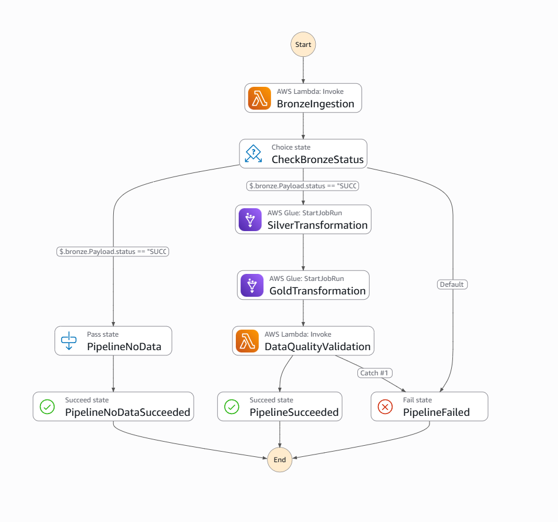

**Evidence:** The state machine definition and visual workflow. The graph is architectural evidence; a separate execution screenshot establishes which path actually ran.

## 2. Scheduled pipeline execution

The EventBridge-triggered state machine execution `wistia-daily-2026-10-25` **succeeded** on October 26, 2026. The execution list showed a start at approximately **3:00:47 AM Central** and a duration of approximately **2.531 seconds**. The preceding `wistia-daily-2026-10-24` execution also succeeded.

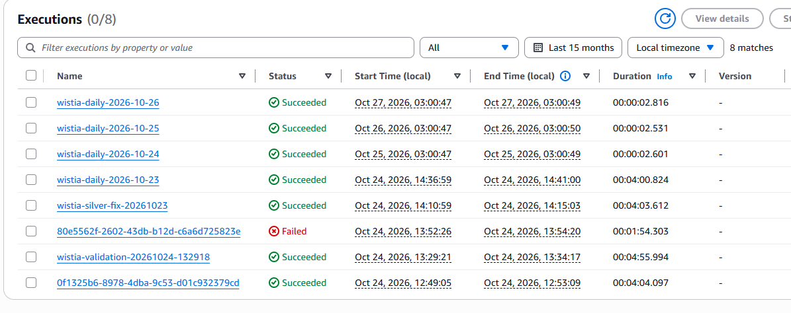

**Evidence:** Automatic daily execution and successful Step Functions completion. A successful execution does not, by itself, establish that new records were ingested.

## 3. Execution path and branching

The execution graph records the states traversed during the selected run. In particular, distinguish the **NO_DATA** branch from the Silver → Gold → data-quality path. A NO_DATA completion is an expected, valid result when no events are available.

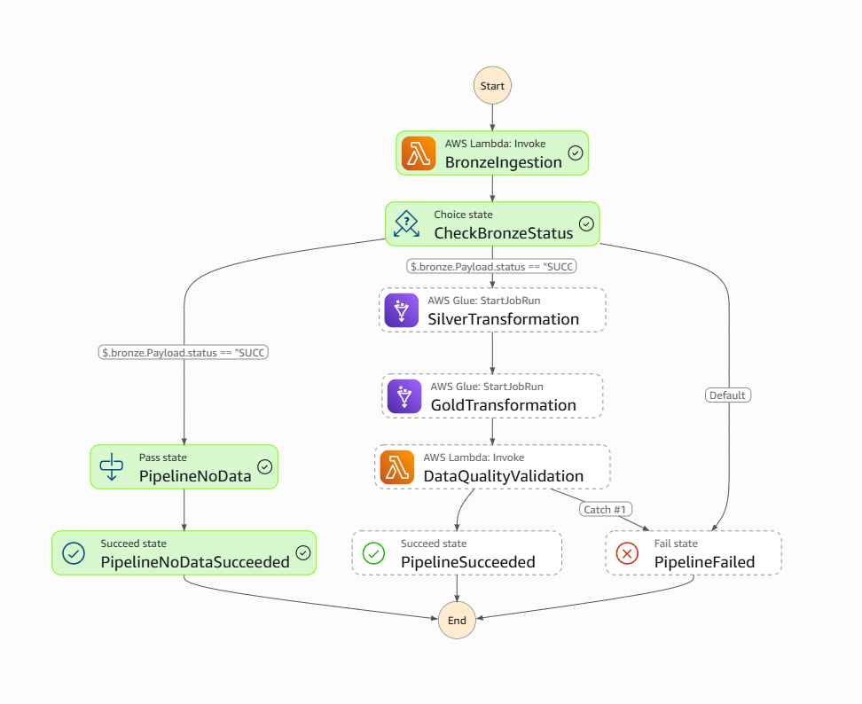

**Evidence:** Branch taken by the execution shown in the screenshot. Do not describe this run as a full transformation run unless the image explicitly shows those states executed.

## 4. Bronze ingestion and storage

The Bronze layer retains raw Wistia event ingestion outputs in Amazon S3, with a processing-date manifest used to determine whether downstream transformations should run.

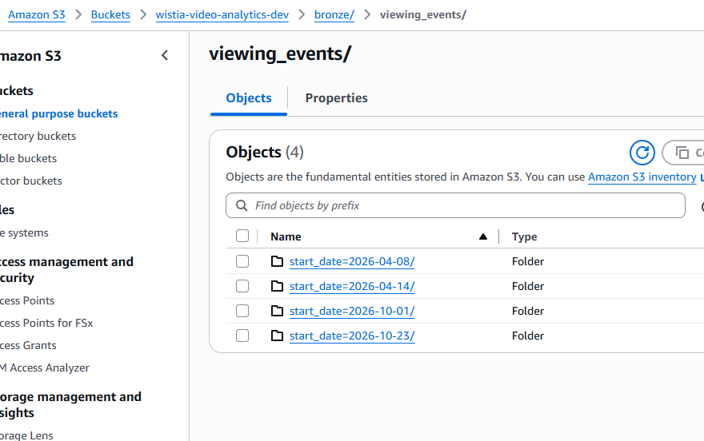

**Evidence:** S3 object structure and ingestion artifacts visible in the captured console. Object presence is distinct from validating all source records.

## 5. Silver transformation

AWS Glue performs the Silver-stage transformation of ingested event data into a curated form for downstream analytics.

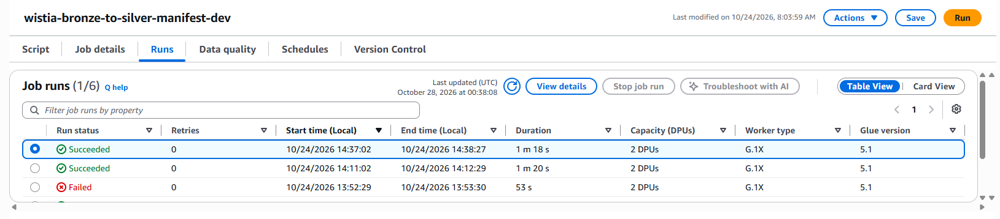

**Evidence:** Silver job configuration/run history shown in AWS Glue. Use the job status and date visible in the screenshot when discussing a specific run.

## 6. Gold transformation

AWS Glue builds analytics-oriented Gold datasets from curated Silver data, making them available for Athena and the Streamlit dashboard.

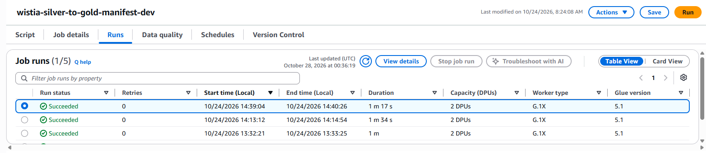

**Evidence:** Gold job configuration/run history shown in AWS Glue. This does not imply the job ran on every NO_DATA day.

## 7. Athena analytics validation

Athena provides SQL access to the Gold analytics outputs. Three query-result screenshots document distinct analytical views. These images should show the query text, selected table or view, and the returned results.

### 7.1 Daily video performance

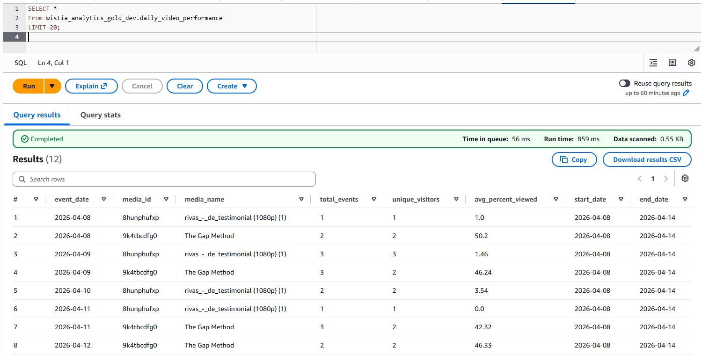

### 7.2 Geographic performance

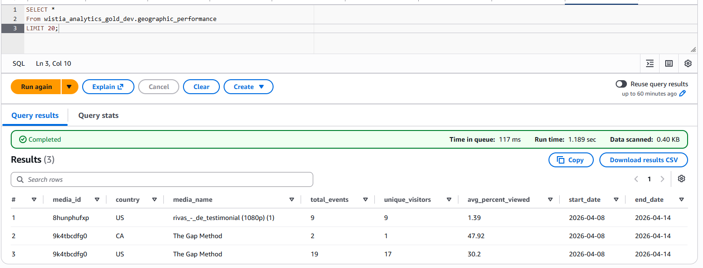

### 7.3 Video performance

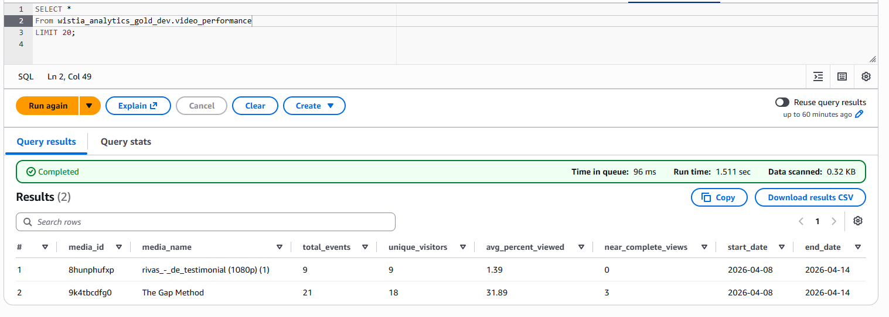

**Evidence:** Query execution and results as displayed at capture time. Avoid interpreting row counts or business trends without examining the underlying results and query filters.

## 8. Streamlit analytics dashboard

The Streamlit application presents Wistia analytics in an interactive dashboard backed by the project's analytics datasets. The three captures document separate dashboard views or sections.

### 8.1 Dashboard overview

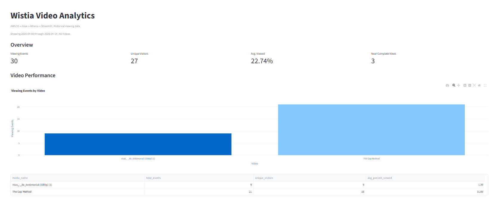

### 8.2 Dashboard analytics view

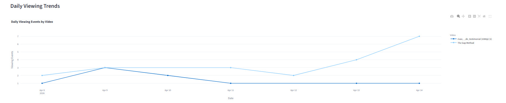

### 8.3 Additional dashboard analysis

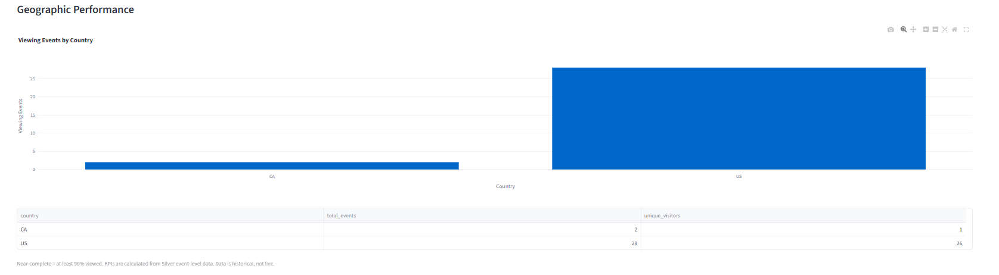

**Evidence:** Application UI and visualizations at the time of capture. The exact KPIs and filters should be read from each screenshot rather than inferred from its filename.

## 9. EventBridge Scheduler

Two enabled EventBridge schedules automate daily operations in the `America/Chicago` timezone:

| Schedule | Intended local time | Target |
| --- | --- | --- |
| `wistia-video-analytics-daily-dev` | 3:00 AM Central | `wistia-pipeline-scheduler-dev` Lambda |
| `wistia-pipeline-watchdog-daily-dev` | 4:00 AM Central | `wistia-pipeline-watchdog-dev` Lambda |

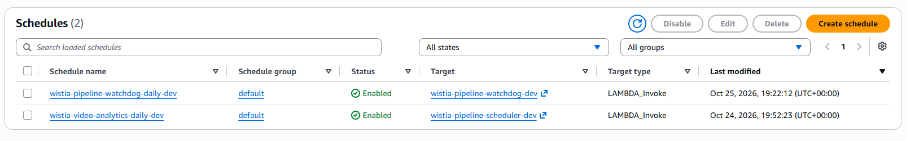

**Evidence:** Both schedules displayed as enabled and mapped to their Lambda targets. The actual run evidence appears in Sections 2 and 10.

## 10. Watchdog execution

The watchdog independently checks for the expected Step Functions execution for the previous Central-calendar day. On October 26, 2026, its CloudWatch log reported:

```json
{
  "status": "FOUND",
  "processing_date": "2026-10-25",
  "execution_name": "wistia-daily-2026-10-25",
  "execution_status": "SUCCEEDED",
  "alert_sent": false
}
```

The log stream's last event was around **09:00:21 UTC**, corresponding to approximately **4:00:21 AM Central**.

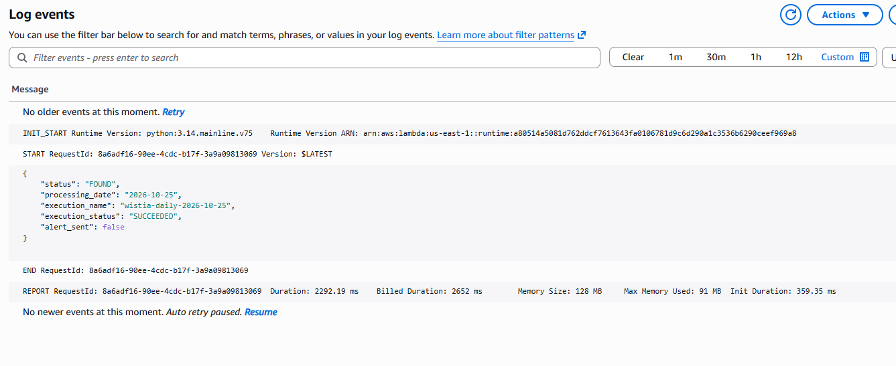

**Evidence:** Successful watchdog invocation, expected execution located, and no missing-run alert sent. This verifies the normal FOUND path; the missing-run alert path is covered by unit tests rather than a demonstrated live outage.

## 11. CloudWatch alerting

Four CloudWatch alarms cover Step Functions failures, timeouts, aborts, and watchdog Lambda errors:

- `wistia-pipeline-execution-failed-dev`
- `wistia-pipeline-execution-timeout-dev`
- `wistia-pipeline-execution-aborted-dev`
- `wistia-pipeline-watchdog-errors-dev`

The alarms have notification actions enabled, using the Wistia SNS alerts topic. During the recorded review, the three Step Functions alarms were **OK** and the watchdog error alarm displayed **Insufficient data**; that status is not proof of a Lambda failure.

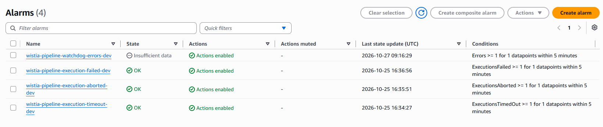

**Monitoring limitation:** An alarm on Lambda `Errors` does not independently detect a watchdog schedule that never invokes the Lambda. A separate heartbeat or invocation-absence check would be needed for that scenario.

## 12. Log retention

The four Lambda log groups use **one-month (30-day) retention**:

- `/aws/lambda/wistia-events-ingestion-dev`
- `/aws/lambda/wistia-pipeline-scheduler-dev`
- `/aws/lambda/wistia-data-quality-validator-dev`
- `/aws/lambda/wistia-pipeline-watchdog-dev`

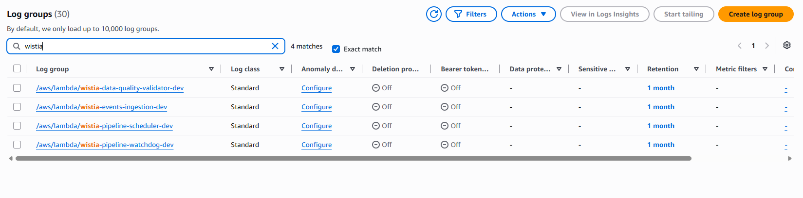

**Evidence:** Retention settings applied to the project's operational Lambda logs.

## 13. Python continuous integration

GitHub Actions runs Python validation and unit tests against repository changes. The CI run for commit `8a73c11` (`Add watchdog Lambda monitoring and CI/CD deployment`) succeeded. Local testing also reported **12 passing unit tests**, covering scheduler behavior, Central-time date calculation, and watchdog outcomes.

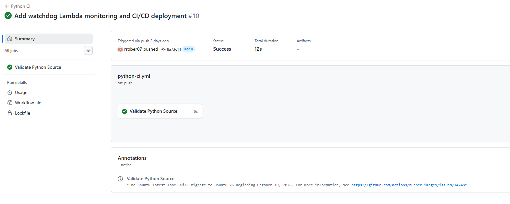

**Evidence:** Successful CI execution for the watchdog changes.

## 14. Lambda continuous deployment

The `Deploy Wistia Lambdas` workflow uses manual, confirmation-gated deployments, builds ZIP packages, authenticates to AWS with GitHub OIDC, and updates the selected Lambda. The watchdog deployment workflow completed successfully; the `verify-only` run also passed without deploying code.

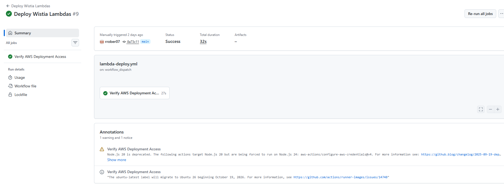

**Evidence:** Package build, AWS authentication, and watchdog code deployment. The ingestion and scheduler Lambda deployment steps were intentionally skipped in the watchdog-targeted run.

## 15. IAM and GitHub OIDC security

GitHub Actions assumes the AWS IAM role `WistiaGitHubDeployRole` using OIDC rather than storing long-lived AWS access keys in GitHub. The deployment policy restricts `lambda:UpdateFunctionCode`, `lambda:GetFunction`, and `lambda:GetFunctionConfiguration` to three named Lambda functions:

- `wistia-events-ingestion-dev`
- `wistia-pipeline-scheduler-dev`
- `wistia-pipeline-watchdog-dev`

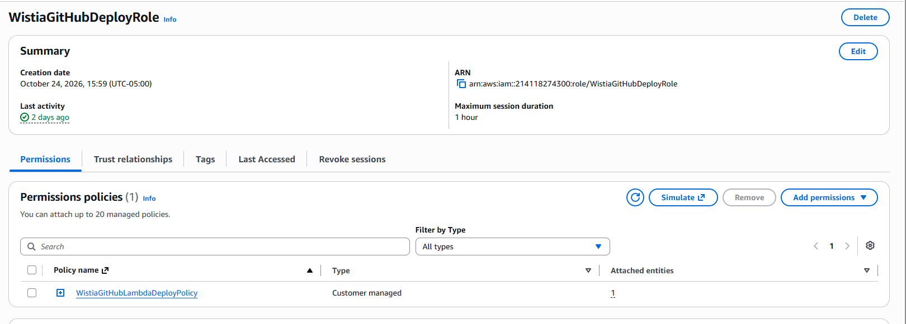

**Evidence:** The IAM deployment role and its permissions configuration. A role screenshot alone is not a full security audit; the successful OIDC workflow is supporting operational evidence.

---

## Verification summary

| Capability | Evidence-based conclusion |
| --- | --- |
| State machine orchestration | Implemented; daily execution succeeded on October 26, 2026 |
| Scheduled daily run | Verified for processing date October 25, 2026 |
| Watchdog schedule | Invoked near 4:00 AM Central and returned FOUND |
| Missing-run alert logic | Unit-tested; no live missing-run incident demonstrated |
| Bronze / Silver / Gold | Implemented; supporting S3 and Glue screenshots captured |
| Athena / Streamlit | Analytics query and dashboard screenshots captured |
| CI/CD | Python CI, verify-only, and watchdog deployment runs succeeded |
| Monitoring | Four CloudWatch alarms configured; SNS actions enabled |
| Log management | Four Lambda log groups configured for 30-day retention |

### Evidence boundaries and follow-up

1. **Data-processing branch:** Read the state-machine execution graph in Screenshot 03 to establish whether the October 26 run followed NO_DATA or processed records. Do not equate `SUCCEEDED` with a fresh Silver/Gold refresh.
2. **Analytical freshness:** Use Athena query filters, table timestamps, or S3 object timestamps to establish the date of the most recently processed records if needed.
3. **Alert delivery:** The screenshots demonstrate configuration and normal watchdog behavior, not a live end-to-end SNS alarm delivery during a failure.
4. **Security:** Screenshots show relevant controls, but do not replace a full IAM, KMS, encryption, and access review.

## Repository navigation

- [Project README](../README.md)
- [Operations runbook](../OPERATIONS_RUNBOOK.md)
- [Screenshot folder](screenshots/)

*Prepared as an evidence-oriented project walkthrough. Screenshot filenames and paths match the supplied VS Code Explorer listing.*
